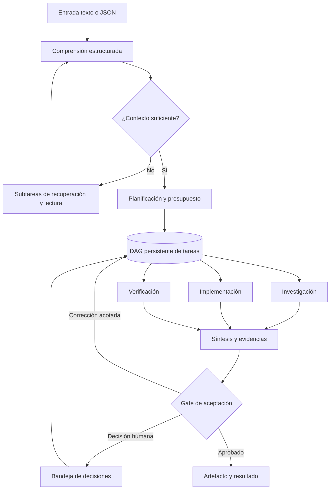

# AIES — Visión 3.0: trabajo autónomo supervisado, aprendizaje por etapas y grafos de tareas

**Estado:** especificación de producto y arquitectura propuesta; **no** implementación ni certificación.  
**Fecha:** 2026-10-15. **Fuente:** `main`, documento `docs/NEXT_HITOS_CONTEXT.md` hasta H02-D2B, inventario H02-A y requisitos del propietario.  
**Regla de precedencia:** código y pruebas actuales para comportamiento implementado; ADR aprobados para restricciones; este documento para dirección futura. Ante contradicción, registrar ADR y migración, nunca reinterpretar silenciosamente.

## 1. Decisión de producto

AIES será primero la **organización digital personal del propietario**: asistentes/especialistas capaces de investigar, diseñar, implementar software, verificar y producir entregables con mínima supervisión. Sólo después de demostrar utilidad, bajo costo, estabilidad y carga humana baja, se considerará comercializar como SaaS multiusuario. La rentabilidad y el ahorro de tiempo son resultados que deben medirse, no promesas.

**Principios:** local-first y bajo costo; supervisión por excepciones; tareas pequeñas; persistencia y recuperación; evidencia antes de confianza; control de presupuesto; autorizaciones explícitas; ninguna decisión de modelo equivale a permiso; trazabilidad de fuentes; entrega útil antes que perfección; reutilizar lo existente antes de crear subsistemas.

### Objetivos operativos

1. Permitir que una persona entregue una instrucción en texto libre o un JSON tipado y reciba un trabajo verificable.
2. Ejecutar en segundo plano tareas autorizadas y avisar sólo por decisiones, fallos no recuperables y entregables terminados.
3. Descomponer problemas en un **DAG persistente** de subtareas pequeñas, paralelizables cuando sean independientes; conservar relaciones entre resultados, decisiones y fuentes.
4. Construir primero dos productos internos: **ingeniero de software supervisado** e **investigador supervisado**.
5. Medir tiempo humano, coste de inferencia/herramientas, calidad, valor económico y porcentaje de trabajos completados sin intervención.

### No objetivos iniciales

- SaaS público, facturación multi-tenant o agentes que se auto-otorgan capacidades.
- Publicación, merge, compras, licitaciones, comunicaciones externas o contratos sin aprobación específica.
- Aprendizaje como reentrenamiento automático de pesos o modificación no aprobada de políticas.
- Búsqueda recursiva ilimitada, optimización infinita, resultados sin evidencia o garantía de exactitud.

## 2. Modelo mental: trabajo como grafo, no conversación lineal



**DAG:** cada tarea es un nodo, cada dependencia es una arista dirigida; no se permiten ciclos en un plan ejecutable. Las iteraciones se representan como **nuevas revisiones/nodos**, con `parentTaskId`, `iteration`, `supersedes` y evidencias, nunca como aristas circulares. Un proyecto puede contener varios DAG relacionados; los resultados intermedios se versionan y se agregan mediante tareas de síntesis.

### 2.1 Entidades propuestas

| Entidad | Propósito | Campos mínimos |
|---|---|---|
| Goal | Intención y resultado esperado | `goalId`, owner, constraints, successCriteria, budget |
| WorkItem | Trabajo solicitado y estado global | `workId`, goalId, inputRef, workflowVersion, status |
| TaskNode | Unidad mínima planificada | `taskId`, workId, type, specialistRequirement, inputs, outputs, dependencies, acceptanceCriteria, risk, budget, retryPolicy |
| TaskAttempt | Intento auditable | `attemptId`, taskId, model/tool version, start/end, cost, outcome, evidenceRefs |
| Artifact | Producto inmutable/versionado | `artifactId`, kind, hash, provenance, storageRef |
| Evidence | Fuente, prueba o comprobación | `evidenceId`, origin, retrievedAt, citation, hash, confidence |
| DecisionRequest | Excepción humana | `decisionId`, reason, options, consequences, expiry, requiredAuthority |
| LearningRecord | Aprendizaje operativo verificable | `learningId`, trigger, observation, proposedChange, evaluation, approval, applicability |
| PolicySnapshot | Autorización y límites efectivos | policyVersion, subject, tools, resources, spendLimit, validity |

Todos los IDs, estados y esquemas deberán tener versión; correlación `goalId/workId/taskId/attemptId/traceId`; entradas y artefactos potencialmente sensibles se referencian por identificador, no se copian a logs.

### 2.2 Máquina de estados

`RECEIVED → UNDERSTANDING → CONTEXT_RESOLUTION → PLANNED → READY → RUNNING → VERIFYING → COMPLETED`.

Ramas controladas: `WAITING_HUMAN`, `RETRY_SCHEDULED`, `BLOCKED`, `FAILED`, `CANCELLED`, `EXPIRED`. Transiciones atómicas con CAS, idempotencia, lease/heartbeat y recuperación. Una tarea bloqueada no autoriza continuar con dependientes. Estados terminales y motivos deben conservarse.

## 3. Etapa I — Comprender la solicitud (Understanding)

### 3.1 Dos vías de entrada

**JSON validado:** si la entrada declara `schemaVersion`, `intent`, `constraints`, `deliverables`, `acceptanceCriteria` y recursos, validar contra JSON Schema; no pedir a un modelo que reinterprete campos deterministas. Campos desconocidos, privilegios o referencias no autorizadas deben rechazarse o pasar a aclaración, según política.

**Texto libre:** enviar a un modelo de interpretación con **template de salida estructurada**, temperatura/aleatoriedad controlada cuando sea posible, límites de tokens y validación estricta. El modelo **propone** intención, supuestos y necesidades de contexto; un validador determinista decide si la propuesta es aceptable.

#### Contrato conceptual `UnderstandingResult/v1`

```json
{
  "schemaVersion": "aies.understanding.v1",
  "intent": "implement_feature",
  "objective": "Agregar una capacidad concreta y comprobable",
  "constraints": ["no modificar main", "sin publicar"],
  "deliverables": ["pull_request_draft", "test_report"],
  "acceptanceCriteria": ["pruebas requeridas aprobadas"],
  "assumptions": [],
  "openQuestions": [],
  "contextRequests": [
    {"kind": "repository", "reference": "owner/repo", "purpose": "inspeccionar arquitectura"}
  ],
  "riskSignals": ["external_write"],
  "confidence": "medium",
  "needsHumanClarification": false
}
```

Este ejemplo es **propuesta de esquema**, no API existente. `confidence` no es autorización ni probabilidad calibrada. `intent` debe pertenecer a un catálogo versionado; no aceptar instrucciones del texto como política del sistema.

### 3.2 Resolver referencias y contexto en ciclos acotados

El intérprete puede emitir `contextRequests` tipadas: `url`, `repository`, `document`, `previous_work`, `local_file`, `search_query`, `database_query`. Un **Context Resolver** distinto del modelo verifica autorización, allowlist/denylist, SSRF, límites de descarga, tamaño, MIME, secretos, permisos y procedencia; obtiene recursos usando adaptadores de herramientas, no URLs arbitrarias ejecutadas por el modelo.

Para cada referencia: `ResolveReference → Fetch/Read → Extract → SourceSummary/v1 → EvidenceStore`. Si hay varias referencias, pueden leerse en paralelo bajo límite de concurrencia. Luego `ContextSynthesis/v1` integra resúmenes, detecta contradicciones, señala vacíos y devuelve nueva interpretación. Cada resumen enlaza su fuente exacta y fecha; los documentos recuperados son **datos no confiables** (defensa contra prompt injection).

**Límites por defecto propuestos para piloto, configurables por operador:** máximo 3 ciclos de comprensión, 8 referencias por ciclo, 2 saltos de referencias enlazadas, 30 tareas de contexto, 4 tareas simultáneas, y presupuesto por trabajo. No se recorre indiscriminadamente toda una web ni se sigue un enlace por mera sugerencia de una fuente. Si falta información tras agotar límites: `NEEDS_CLARIFICATION` o resultado parcial con incertidumbre explícita.

### 3.3 Templates como contratos, no prompts sueltos

Catálogo versionado con: `templateId`, `schemaVersion`, `inputSchema`, `outputSchema`, `systemPolicyRef`, `allowedTools`, `evaluationSuite`, `modelCompatibility`, `maxTokens`, `timeout`, `retryBudget`, `humanGate`. Plantillas iniciales: `UnderstandRequest/v1`, `ResolveReference/v1`, `SummarizeSource/v1`, `SynthesizeContext/v1`, `DecomposeGoal/v1`, `SolveTask/v1`, `VerifyTask/v1`, `SummarizeWork/v1`.

Cada invocación: validar entradas → ensamblar contexto mínimo → invocar modelo → validar JSON → verificar reglas → persistir resultado y evidencia → emitir evento durable. JSON inválido: una reparación acotada, después rechazo/clarificación; nunca parseo permisivo que otorgue permisos.

## 4. Etapa II — Buscar solución y planificar

Tras `UnderstandingResult` aceptado, el **Solution Planner** decide entre: respuesta directa con evidencia; ejecución de una tarea simple; DAG de subtareas; aclaración; o rechazo por política. Antes de generar un DAG grande, elaborar un plan de alto nivel y presupuesto.

### 4.1 Descomposición jerárquica

`Goal → Epic/Outcome → Task → AtomicTask → Attempt`. Una tarea atómica debe tener una salida comprobable, dependencias explícitas, especialista/capacidad requerida, costo estimado y criterio de finalización. Objetivo piloto: unidades de 1–10 minutos de ejecución acotada, sin tratar esa duración como garantía. No dividir por dividir: el coste de coordinación puede superar el beneficio.

**Ejemplo de software:** comprender requerimiento → inspeccionar repo → definir cambio mínimo → implementar módulo A y tests B en paralelo cuando no comparten archivos → integración → pruebas → revisión independiente → PR preparado → aprobación humana.

**Ejemplo de investigación:** entender pregunta → localizar fuentes primarias → descargar fuentes autorizadas en paralelo → resúmenes citados → síntesis cruzada → verificación de afirmaciones → informe con incertidumbre → recomendaciones.

### 4.2 Planificación iterativa y convergencia

Plan inicial **versionado**; el scheduler sólo despacha nodos `READY` con dependencias satisfechas. Al aparecer un hallazgo, un agente puede proponer `PlanRevision` con motivo, diff de DAG, impacto de costo/plazo y riesgos. Un validador verifica aciclicidad, permisos, presupuesto y criterios; los cambios sensibles requieren aprobación. Mantener histórico, no reescribir resultados anteriores.

**Regla anti-perfeccionismo:** terminar cuando se cumplan criterios de aceptación y un gate independiente apruebe. Si un intento de mejora tiene bajo beneficio marginal o supera presupuesto, detener con resultado suficiente y limitaciones. Propuesta piloto: 2 rondas de corrección por tarea, 3 revisiones del plan, límite global de nodos y coste; todos los límites se fijan por perfil de riesgo y se miden.

### 4.3 Paralelismo seguro

Despachar tareas independientes en paralelo con cupos por modelo, herramienta, repositorio, presupuesto y memoria/GPU. Reservar recursos antes del intento. Evitar escrituras concurrentes sobre el mismo archivo/branch; usar worktrees aislados y merge/integración serializada. No afirmar aceleración lineal: el cuello de botella puede ser inferencia, herramientas, integración o revisión.

## 5. Etapa III — Ejecutar, verificar y entregar

Cada especialista es una **capacidad gobernada**, no un actor omnipotente. La selección usa registro/versiones/competencias, pero una decisión `SELECTED` **nunca autoriza** herramienta o recurso. Verificar elegibilidad y autorización nuevamente justo antes de cada uso; registrar versión de política y perfil. Sandbox sin red por defecto para ejecución de código; red mediante herramienta de lectura restringida cuando corresponda. Secretos no disponibles para modelos por defecto.

Resultados de cada nodo: `TaskResult/v1` con `status`, `artifactRefs`, `evidenceRefs`, `qualitySignals`, `cost`, `nextActions`, `uncertainties`. Gate determinista cuando sea posible (tests, lint, schema, hashes); revisión de modelo como complemento, no sustituto. Un integrador sintetiza outputs sin borrar discrepancias. Publicación, PR merge, pagos y presentaciones externas siempre sujetos a política y aprobación específica.

**Entrega final:** artefactos + criterios cumplidos/no cumplidos + evidencia + costos + decisiones pendientes + límites conocidos + acciones recomendadas. Si algo falla, entregar diagnóstico o parcial honesto, no marcar `COMPLETED`.

## 6. Aprendizaje como tarea explícita y auditable

El aprendizaje es un **workflow** separado, disparado por resultados, errores repetidos, feedback humano o métricas, no una mutación automática de producción:

1. `Observe`: capturar fallo, desviación, retrabajo, costo y evidencia.
2. `Diagnose`: analizar causa raíz, diferenciar problema de prompt, herramienta, fuente, modelo, plan o requisito.
3. `Propose`: generar cambio concreto a template, política de descomposición, heurística, test o runbook.
4. `Evaluate`: ejecutar benchmark/replay contra casos previos y adversariales, medir regresiones, coste y calidad.
5. `Approve`: revisión humana para cambios de permisos, políticas, prompts productivos y configuración sensible.
6. `Publish`: versionar y desplegar canary/feature flag con rollback.
7. `Monitor`: comprobar mejora real; revertir si empeora.

Guardar `LearningRecord` con trazabilidad. Recuperación de conocimiento (`retrieval`) es diferente de entrenamiento; ninguna observación privada debe convertirse automáticamente en dato compartido entre usuarios. Al futuro SaaS: aislamiento por tenant y consentimiento específico.

## 7. Supervisión por excepciones y autonomía

| Nivel | Permiso máximo de producto | Control |
|---|---|---|
| A0 | Asesorar y planificar | Sin herramientas de ejecución |
| A1 | Investigar y leer recursos autorizados | Red y fuentes restringidas |
| A2 | Producir artefactos en sandbox y preparar PR | Sin merge/publicación |
| A3 | Ejecutar rutinas internas reversibles preaprobadas | Políticas, límites y auditoría |
| A4 | Acciones externas con efectos legales/económicos | Aprobación humana específica por operación |

Estos niveles no reemplazan autorización por sujeto/acción/recurso. La **Human Decision Inbox** agrupa `APPROVAL_REQUIRED`, `AMBIGUITY`, `BUDGET_EXCEEDED`, `SECURITY_BLOCK`, `QUALITY_FAILURE`, `DELIVERABLE_READY`; evita notificar progreso rutinario. Caducidad y revalidación al reanudar; nunca ejecutar aprobación antigua con parámetros distintos.

## 8. Arquitectura propuesta y reutilización

| Capacidades existentes (según inventario/roadmap) | Decisión | Integración futura |
|---|---|---|
| Registro versionado, manifiestos, gobernanza, SQLite | **Reutilizar** | Catálogo de especialistas, procedencia y aprobación |
| H02-B/C/D selector, facade, runtime, Event Bus v1 | **Completar y adaptar** | Selección de capacidad; preservar contrato legacy |
| TeamPlanner y CapabilityRouter preview | **Mantener temporalmente** | Evaluar adaptadores al planificador DAG; no borrar sin prueba de consumidores |
| Orquestación/planificación/ejecución existente | **Inventariar y reutilizar** | Elegir un dueño de estado por workflow; evitar scheduler duplicado |
| Outbox, reconciliación, recovery, idempotencia | **Reutilizar** | Eventos durables, replay y consistencia |
| Workspace changes, verificación aislada, quality gates | **Integrar** | Producción de software con evidencias |
| Modelos locales y proveedores opt-in | **Reutilizar** | Router según costo/capacidad, límites y privacidad |
| Nuevos contratos de Understanding/Context/Learning | **Agregar por fases** | Sin reemplazar endpoints existentes prematuramente |

**Prohibición de eliminación prematura:** antes de retirar una ruta duplicada, inventariar referencias estáticas y dinámicas, CDI, endpoints, jobs, tests, configuración y consumidores reales; implementar adaptador o migración, ejecutar tests de equivalencia, habilitar telemetría, establecer rollback, deprecar y recién eliminar. No confundir 'no observado' con 'no usado'.

### 8.1 Componentes lógicos (no necesariamente microservicios)

`Intake → Understanding → ContextResolver → Planner → DurableDAG/Scheduler → SpecialistExecution → Verification → Synthesis → DecisionInbox/Delivery`.

Transversales: `PolicyEngine`, `EvidenceStore`, `ArtifactStore`, `BudgetLedger`, `LearningWorkflow`, `Observability`. Preferir módulos dentro del control-plane actual antes que nuevos servicios, bases o colas. SQLite puede servir piloto single-node; diseñar contratos para migración futura sin prometer escalado multi-host con SQLite.

## 9. Versiones y secuencia de implementación

**La nomenclatura V3.x es roadmap de producto, no versión semántica ya publicada.** No sustituye los hitos H02/F4 abiertos.

| Versión objetivo | Entrega demostrable | Dependencia / salida |
|---|---|---|
| **V3.0 — Baseline seguro** | Cerrar H02-D2C/H02-E/F con pruebas de compatibilidad, revalidación en despacho, métricas, rollback y E2E | Sin activar gobernanza por defecto; F4/G10-K sólo se cierra con su evidencia específica |
| **V3.1 — Intake & Understanding** | Entrada JSON/texto, templates versionados, parser validado, aclaración y evidencia | Tests de JSON inválido, inyección y entradas ambiguas |
| **V3.2 — Context & Research** | Resolución de URLs/documentos/repositorios, resumen por fuente y síntesis iterativa | Fuentes trazables, límites y protección SSRF |
| **V3.3 — Durable Task Graph** | DAG persistente, tareas atómicas, paralelismo acotado, revisiones y recovery | CAS/idempotencia, crash/restart, límites de coste |
| **V3.4 — Autonomous Software Engineer** | Ticket → rama/worktree → implementación → pruebas → revisión → PR preparado | Sandbox, política de repo, no merge automático |
| **V3.5 — Human Inbox & Learning** | Aprobaciones, excepciones, feedback, experimentos de templates, rollback | Auditabilidad y medición de intervención |
| **V3.6 — Personal Business Operations** | Portafolio, investigaciones comerciales, propuestas, seguimiento de oportunidades y valor | Sin envíos ni gastos no autorizados |
| **V4.0 — SaaS candidato** | Tenant isolation, cuotas, privacidad, billing, soporte, seguridad y SLO | Sólo si piloto interno prueba utilidad y rentabilidad |

### 9.1 Hitos técnicos inmediatos (no saltarlos)

- **H02-D2C2:** revalidación de estado/hash y autorización efectiva al despacho; evitar TOCTOU; tests de revocación entre selección y ejecución.
- **H02-D2C3:** métricas de selección, shadow read-only sin efectos, rollback, E2E de flags y fallos.
- **H02-E:** reconciliación integral, consistencia de provenance/estado/outbox en ruta de ejecución.
- **H02-F:** E2E real y migración progresiva, inventario de duplicaciones y eliminación con evidencia.
- **F4/G10-K:** permanece **OPEN** hasta certificación independiente; no inferir cierre desde pruebas unitarias de H02.

### 9.2 Vertical slices y gates por versión

Cada versión debe entregar **un flujo útil extremo a extremo**, no sólo DTOs. Para cada slice: ADR → contratos JSON/Java → amenazas y permisos → persistencia/migración → implementación flag-off → tests unitarios/integración/crash → observabilidad → prueba piloto real → runbook/rollback → decisión humana de activar. Un incremento pequeño por PR, actualizado en `NEXT_HITOS_CONTEXT.md` con evidencia real y limitaciones.

## 10. Presupuestos, calidad y métricas

Límites por `workId`: `maxTokens`, `maxModelCalls`, `maxWallClock`, `maxTasks`, `maxDepth`, `maxParallel`, `maxRetries`, `maxExternalReads`, `maxSpend`, `maxHumanInterruptions` (este último no puede silenciar alertas críticas). Política de admisión reserva presupuesto para verificación y síntesis; no agotar todo en investigación.

**Indicadores piloto (metas propuestas, no resultados):** trabajos terminados sin intervención ≥70%; aceptación inicial ≥80%; tiempo humano ≤15 min/trabajo estándar; cero acciones fuera de política; 100% de resultados con evidencias y coste registrado; medir p50/p95, coste por entregable, retrabajo, latencia, fallos de herramientas, tareas bloqueadas y tasa de falsos positivos de alertas. No optimizar solo llamadas/segundo.

## 11. Seguridad, legalidad y operación

- Entradas y fuentes son no confiables; separación estricta instrucciones/datos; prompt injection y exfiltración como amenazas principales.
- Protección SSRF y egress; prohibir acceso a metadata cloud, localhost, redes privadas y credenciales salvo adaptador y autorización explícita.
- En Git: mínimo privilegio, ramas protegidas, tokens con alcance limitado, revisión antes de merge; registrar diffs y tests.
- Para investigación pública y oportunidades comerciales: respetar términos, derechos de autor, datos personales, veracidad de declaraciones, requisitos de convocatorias y plazos. Ninguna postulación oficial automática sin aprobación.
- Reanudación durable, idempotencia, backpressure, cancelación, rate limits y degradación controlada; sin prometer exactamente-una-vez de transporte.
- Observabilidad sin secretos ni PII; retención y borrado definidos; costos y facturas reales separados de estimaciones.
- Proteger empleo principal y propiedad intelectual: no usar recursos/datos del empleador sin autorización.

## 12. Primeros experimentos de aceptación

**Piloto A: investigador.** Entrada textual ambigua con dos URLs y una referencia a un trabajo previo autorizado; AIES genera `UnderstandingResult`, resuelve fuentes, produce resúmenes citados, identifica contradicción, limita iteraciones y entrega informe con evidencias; una URL maliciosa debe bloquearse.

**Piloto B: ingeniero.** Solicitud de mejora en repo de prueba; genera DAG, ejecuta tareas independientes en worktrees, crea tests, reintenta un fallo dentro de presupuesto, produce PR draft y espera aprobación para merge; revocación de permisos durante ejecución debe impedir nuevas acciones.

**Piloto C: recovery.** Terminar proceso a mitad de una tarea; reiniciar; no duplicar cambios ni cargos, no perder evidencia, no aprobar tácitamente ni completar tareas dependientes de fallo.

**Piloto D: aprendizaje.** Una ejecución falla por template defectuoso; generar propuesta, replay contra fixtures, comparar métricas, aprobar versión nueva, activar canary y revertir ante regresión.

## 13. Registro de decisiones por formalizar

- ADR-V3-001: ownership de scheduler/DAG y compatibilidad con orquestación actual.
- ADR-V3-002: versionado y validación de templates/contratos.
- ADR-V3-003: Context Resolver, permisos de red y modelo de evidencia.
- ADR-V3-004: políticas de autonomía y bandeja de decisiones.
- ADR-V3-005: presupuesto, stop conditions y estrategia de paralelismo.
- ADR-V3-006: ciclo de aprendizaje, evaluación, promoción y rollback.
- ADR-V3-007: límites del piloto single-node y criterios para SaaS.

**Regla de gobierno del roadmap:** este documento define la dirección; `docs/NEXT_HITOS_CONTEXT.md` sigue siendo el registro cronológico de entregas, validaciones y próximo hito. No reescribir hitos históricos ni declarar implementado lo que aquí sólo está diseñado.
