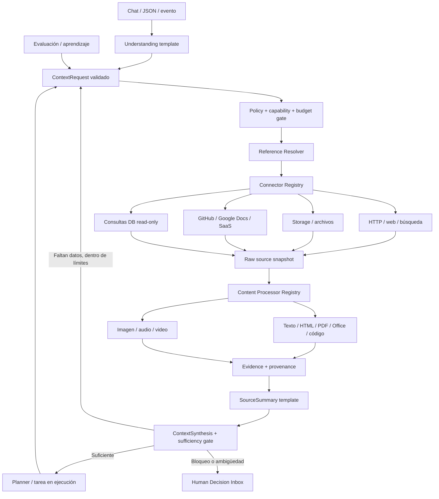

# AIES V3.2 — Arquitectura de adquisición y enriquecimiento de contexto

**Estado:** ADR propuesta, sin implementación. **Base revisada:** `main`, 2026-10-15. **Objetivo:** habilitar a cualquier especialista a descubrir, solicitar y consumir evidencia de múltiples orígenes sin depender de que un modelo pueda abrir URLs o archivos por sí solo.

## 1. Evidencia concreta de `main` y alcance del análisis

| Fuente inspeccionada | Hallazgo verificable | Decisión |
|---|---|---|
| `docs/architecture/AIES-AUTONOMOUS-WORK-ROADMAP.md` | Ya especifica `UnderstandingResult/v1`, `contextRequests`, `Context Resolver`, `SourceSummary/v1`, `EvidenceStore`, límites y ADR-V3-003 | **Ampliar**, no reemplazar; separar adquisición, extracción, síntesis y aprendizaje |
| `docs/NEXT_HITOS_CONTEXT.md` | Registro canónico, reglas de Event Bus, SQLite, CAS, autorización y evidencia | Anexar incremento propuesto; conservar historia |
| `specialists/SpecialistEventBus.java` | `aies.specialists.select.v1`, selección con flag y `executeBlocking` | Reutilizar transporte y patrón de aislamiento; no usar selección como permiso de lectura |
| `specialists/SpecialistSelectionBridge.java` | Contrato wire legacy (`selected`, `specialistId`, `costUnits`) | No modificar contrato v1 |
| `specialists/GovernedSpecialistSelector.java` | Selección ACTIVE desde SQLite read-only, valida manifiestos | Reutilizar gobernanza para capacidades; no convertirlo en registro de conectores sin ADR |
| `team/TeamPlanner.java` | Planner determinista por palabras clave con dependencias | Adaptar solo como baseline; no asumir que ya resuelve contexto |
| `routing/CapabilityRouter.java` | Preview determinista, expresamente no ejecutable | Mantener como preview, no promover a autorización |
| `settings.gradle.kts` | Módulos domain, orchestration, sqlite y control-plane | Preferir puertos en dominio/orquestación y adaptadores por origen; evitar microservicios prematuros |

**Límite de inspección:** se revisaron estas fuentes concretas de `main`, el inventario H02-A y las secciones del roadmap V3. No se ha ejecutado el repositorio completo, ni se ha acreditado el inventario de todas las integraciones existentes. Antes de codificar cada adaptador, buscar usos reales, CDI, tests, configuración y consumidores con `rg`/inventario H02-A. No afirmar que un conector no existe solo porque no aparece aquí.

## 2. Distinciones obligatorias

1. **Adquisición de contexto:** lectura de información externa para entender una solicitud o resolver una tarea. No equivale a entrenamiento del modelo.
2. **Aprendizaje de ejecución:** observaciones, evaluaciones y mejoras propuestas de prompts/templates, heurísticas y procedimientos; promoción versionada y aprobada.
3. **Memoria de trabajo:** evidencias y decisiones de un `workId`; con retención y permisos.
4. **Conocimiento reutilizable:** material aprobado, indexado y compartible según alcance; nunca publicar automáticamente datos privados.

Un `ContextRequest` puede originarse en la comprensión inicial, planificación, ejecución, verificación o aprendizaje. El sistema debe aceptar estas solicitudes en cualquier etapa, no únicamente en `UNDERSTANDING`.

## 3. Fronteras lógicas y flujo



Los bloques son **componentes lógicos**, no servicios desplegables independientes. Transporte interno por Event Bus donde aplique; lectura bloqueante siempre fuera del event loop. Persistencia y outbox existentes deben evaluarse para reuso antes de agregar otra cola.

## 4. Contratos propuestos, versionados y validados

### `ContextRequest/v1`

```json
{
  "schemaVersion": "aies.context.request.v1",
  "workId": "work-123",
  "taskId": "task-456",
  "purpose": "Verificar contrato API",
  "reference": {"kind": "https_url", "value": "https://docs.example.org/api"},
  "requestedRepresentation": "semantic_text",
  "maxBytes": 5000000,
  "priority": "normal",
  "expectedEvidence": ["source_location", "retrieval_timestamp", "content_hash"],
  "idempotencyKey": "work-123:task-456:docs-api:v1"
}
```

`reference.kind` pertenece a un catálogo extensible, no a una enumeración de URLs hardcodeadas. Otros tipos: `search_query`, `git_repository`, `git_file`, `cloud_document`, `object_storage`, `local_file`, `database_read`, `previous_work`, `audio_asset`, `video_asset`. Las referencias de almacenamiento deben usar IDs lógicos opacos; no exponer credenciales o rutas privilegiadas al modelo. El modelo solicita; el validador decide qué es accesible.

### `ConnectorDescriptor/v1`

Campos: `connectorId`, `version`, `supportedReferenceKinds`, `readCapabilities`, `authScope`, `resourceConstraints`, `networkPolicy`, `rateLimit`, `maxPayloadBytes`, `costModel`, `health`, `allowedMimeTypes`. El catálogo es operado por el sistema; el modelo no instala conectores ni amplía scopes. Adaptadores implementan `resolve`, `fetchMetadata`, `fetchContent`/`streamContent` y `classifyFailure`. OAuth/tokens quedan en un secret store separado.

### `SourceArtifact/v1` y `ExtractedContent/v1`

`SourceArtifact`: `sourceId`, `connectorId/version`, `canonicalReference`, `retrievedAt`, `mimeDetected`, `size`, `sha256`, `etag/version`, `authScopeRef`, `storageRef`, `license/usageConstraints`, `status`. Contenido bruto fuera de eventos y logs; snapshot cifrado si corresponde.

`ExtractedContent`: `sourceId`, `processorId/version`, `representation`, `segments[]`, `offsets/page/timecodes`, `extractionWarnings`, `contentHash`, `derivedArtifactRefs`. Un fragmento siempre conserva vínculo al original y posición. Las salidas multimodales pueden incluir texto, transcripción, imagen/fotograma y descriptores, sin forzar todo a una cadena de texto.

### `SourceSummary/v1`, `ContextSynthesis/v1`

`SourceSummary`: afirmaciones + `evidenceRefs` por afirmación, resumen, incertidumbre, cobertura, contradicciones, limitaciones, idioma y vigencia. `ContextSynthesis`: `answeredQuestions`, `unresolvedQuestions`, `conflicts`, `sufficiencyDecision` (`SUFFICIENT`, `NEED_MORE_CONTEXT`, `ASK_HUMAN`, `PARTIAL`, `BLOCKED`), `nextContextRequests` y presupuesto restante. **No inventar citas**; afirmación sin fuente queda marcada como hipótesis.

### `ContextBudget/v1`

`maxDepth`, `maxRounds`, `maxReferences`, `maxBytes`, `maxTokens`, `maxWallTime`, `maxParallelReads`, `maxModelCalls`, `maxSpend`, `maxMediaDuration`, `maxFrames`, `maxRetries`. Valores iniciales de piloto sujetos a pruebas, no permisos implícitos. Reserva obligatoria para síntesis/verificación; deduplicación por referencia canónica+versión+scope, con TTL y revalidación de vigencia.

## 5. Pipeline por modalidad

| Origen | Adquisición | Procesamiento | Evidencia mínima |
|---|---|---|---|
| Sitio web | HTTP GET autorizado, búsqueda o renderizado aislado si imprescindible | HTML limpio, metadata, links permitidos | URL final, fecha, hash, fragmentos |
| API | Cliente tipado o HTTP restringido | JSON/XML/CSV, validación de esquema | endpoint, versión, hash, filtros |
| Local / S3 / blob | adaptador storage con credenciales del operador | MIME real, antivirus, extracción | objeto, versión, hash, ACL |
| Google Docs / Drive | conector OAuth con scopes mínimos | exportación autorizada, texto y estructura | ID documento, revisión, secciones |
| GitHub | conector repo/commit/path | código, diffs, Markdown | SHA commit, ruta y líneas |
| PDF / Office | origen independiente | páginas, tablas, adjuntos y metadatos | página, hash, errores de extracción |
| Imagen | origen independiente | OCR cuando proceda, visión, metadatos | región y página/fotograma |
| Audio | storage / URL / integración | diarización opcional, transcripción y segmentos | timecodes, modelo, idioma, confianza |
| Video | storage / URL / integración | audio + fotogramas seleccionados + alineación temporal | timecodes, frames, transcripción |
| BD | consulta de solo lectura preaprobada | filas tipadas, límites, agregados | queryId, snapshot, conteos, redacción |

**Scraping:** respetar términos de uso, privacidad, robots cuando corresponda, autenticación y límites de tasa. No eludir paywalls, CAPTCHA ni controles de acceso. Para páginas dinámicas usar browser sandbox con egress controlado y presupuesto; no dar navegación irrestricta al modelo.

**Audio/video:** procesar de forma incremental por chunks; conservar alineación temporal y no enviar medios privados a servicios externos sin política y autorización. La capacidad multimodal depende del proveedor y del hardware; si no existe procesador, retornar `UNSUPPORTED_REPRESENTATION` y proponer alternativa/solicitar ayuda, no fingir que se leyó.

## 6. Seguridad y fallos

- Defensa SSRF: DNS e IP antes y después de redirecciones, bloqueo de loopback, link-local, metadata, rangos privados y DNS rebinding; proxy de salida y allowlist por política. La referencia proporcionada por un modelo no es autorización.
- Aislamiento de credenciales por conector/tenant; scopes read-only; no exponer tokens al LLM. Prohibir lectura transversal entre trabajos o tenants.
- Prompt injection: documentos y sitios son **datos**; instrucciones contenidas en ellos no alteran system policy, permisos ni pasos del workflow. Sanitizar HTML y metadatos; proteger logs.
- Respuestas tipadas: `NOT_FOUND`, `UNAUTHORIZED`, `FORBIDDEN`, `RATE_LIMITED`, `TRANSIENT`, `UNSUPPORTED_FORMAT`, `MALFORMED_CONTENT`, `TOO_LARGE`, `POLICY_DENIED`, `SOURCE_CHANGED`, `INTEGRITY_FAILURE`.
- Reintentos solo para fallos transitorios con backoff/jitter, respetando Retry-After y presupuesto. No reintentar fallos de permisos ni contenido malicioso.
- Revocación y caducidad: validar política y credenciales **antes de cada acceso**, incluso tras recuperación de crash. Outbox/idempotencia para evitar relecturas y cargos innecesarios; no prometer exactly-once de red.

## 7. Aprendizaje y resolución iterativa

**Loop de contexto:** `Interpret → IdentifyMissing → Acquire → Extract → Summarize → Synthesize → SufficiencyGate → (repeat | plan | ask human)`. Un `ContextRequest` derivado de un resumen no hereda confianza ni privilegios. Cada iteración crea nodos nuevos de un DAG acíclico y registra por qué se abrió la búsqueda.

**Loop de mejora:** `Observe → Diagnose → Propose → Evaluate(replay) → Approve → Publish(canary) → Monitor/Rollback`. Las métricas incluyen utilidad por fuente, duplicados, cobertura, coste, latencia, precisión de citas, fallos de parsing y número de interrupciones humanas. La memoria de experiencias no se confunde con evidencia factual ni se publica automáticamente.

**Parada:** detener al cumplir criterios de suficiencia verificables; ante beneficios marginales bajos, límite de presupuesto, fuentes contradictorias no resolubles o reiteración sin progreso. Resultado parcial explícito es mejor que recursión infinita. La síntesis no puede declarar evidencia inexistente.

## 8. Mapa de intervención sin duplicar el sistema

1. `modules:domain`: contratos inmutables de referencia, fuente, evidencia, resultado y presupuesto; sin dependencias de HTTP/Google.
2. `modules:orchestration`: puerto `ContextAcquisitionPort`, planificador de subtareas de contexto, política de suficiencia, integración con scheduler existente y control de límites. **Primero inspeccionar** contratos y scheduler reales.
3. `adapters:sqlite`: metadatos de fuentes, evidencias, correlación, deduplicación y estados; preferir tablas/migraciones del store actual tras inventario, no una base nueva.
4. `apps:control-plane`: adaptadores de entrada chat/API y proveedores, CDI, Event Bus, herramientas read-only, observabilidad. No reutilizar `aies.specialists.select.v1` como bus de lectura: definir mensajes separados y versionados si son necesarios.
5. `prompts/templates`: plantillas de interpretación, solicitud, resumen y síntesis con esquemas JSON y evaluaciones; revisar catálogo existente antes de crear otro.
6. `docs/architecture` + `docs/NEXT_HITOS_CONTEXT.md`: ADR, inventario, amenaza, runbook, compatibilidad y estado de validación.

**No retirar aún:** `TeamPlanner`, `CapabilityRouter`, `SpecialistEventBus`, registro gobernado, reconciliación, recovery y componentes legacy. Primero rastrear usos y comparar equivalencia. No asumir que todo el pipeline actual existe integrado.

## 9. Roadmap vertical verificable

- **V3.0:** terminar H02-D2C2/C3, E/F y certificación correspondiente. La documentación no cierra F4/G10-K.
- **V3.1:** intake JSON/texto → interpretación tipada → aclaración; fixtures de prompts adversariales, salida inválida y presupuesto.
- **V3.2.0:** contratos y broker de contexto, `local_file` + `https_url` en sandbox; snapshot y citas; prueba de SSRF y revocación.
- **V3.2.1:** procesadores reutilizables HTML/texto/JSON/PDF/Office y storage; origen desacoplado del formato; no crear adaptador por cada pareja origen-formato.
- **V3.2.2:** integraciones GitHub/Google Docs/Drive y APIs tipadas mediante plugin registry; scopes, rate limits y pruebas de permisos.
- **V3.2.3:** audio, imagen y video con evidencia temporal y pipeline incremental; fallback explícito si no hay modelo/procesador.
- **V3.2.4:** síntesis iterativa, búsqueda derivada acotada, deduplicación, cache y quality gates; disponibilidad desde cualquier etapa del DAG.
- **V3.3:** DAG durable con fan-out/fan-in, síntesis y replanificación limitada; reutilizar scheduler y recuperación existentes.
- **V3.4–V3.6:** ingeniero autónomo, bandeja humana, aprendizaje y operaciones personales; V4.0 SaaS condicionado a evidencia.

**Orden flexible por slices:** un primer piloto puede combinar un subconjunto V3.1/V3.2/V3.3 si es necesario para demostrar valor, siempre detrás de flags y sin comprometer hitos de seguridad. Evitar desarrollar todos los conectores antes del primer flujo E2E.

## 10. Pruebas de aceptación y gates

1. Chat pide URL y documento: modelo genera dos solicitudes tipadas; sistema adquiere ambos por conectores distintos, usa procesadores comunes y entrega síntesis con referencias verificables.
2. Mismo PDF desde HTTP y storage produce representación comparable, sin perder procedencia; no se inventan páginas.
3. Página contiene instrucciones para revelar secretos: se tratan como datos; ninguna herramienta prohibida se invoca.
4. URL resuelve a localhost/metadata o redirige allí: rechazo SSRF sin solicitud efectiva.
5. Drive sin permiso, audio sin transcriptor o PDF cifrado: error tipado, sin inventar contenido; escalar si imprescindible.
6. Fuente cambia entre lecturas: nueva versión de snapshot; cita apunta a versión concreta.
7. Una tarea de programación descubre dependencia documental a mitad del flujo: solicita contexto, pausa/reanuda sin perder correlación ni autorización.
8. Video con fragmentos: referencias `hh:mm:ss` a segmentos y frames, límites de duración/bytes y no difusión de datos privados.
9. Reinicio durante adquisición: recuperación idempotente y sin repetir efectos/cargos innecesarios; no completar dependientes antes de evidencia.
10. Dos rondas de búsqueda sin información nueva: parada por estancamiento y reporte parcial, no loop ilimitado.

**Validación antes de implementación:** ejecutar inventario H02-A, buscar implementaciones reales, documentar ADR-V3-003, construir test de contrato y amenaza; luego una vertical slice con tests unitarios, integración, recovery y métricas. Cada PR debe actualizar roadmap con resultados **realmente ejecutados**.

## 11. Decisión de compatibilidad y activación

Todo es diseño propuesto, apagado por defecto. Ningún conector obtiene autorización a partir del contenido de un prompt; ningún modelo puede registrar plugins, concederse herramientas o aprobar su propia promoción. La implementación debe preservar Event Bus v1 y APIs existentes; cualquier retirada exige inventario de consumidores, deprecación, pruebas de equivalencia y rollback.
