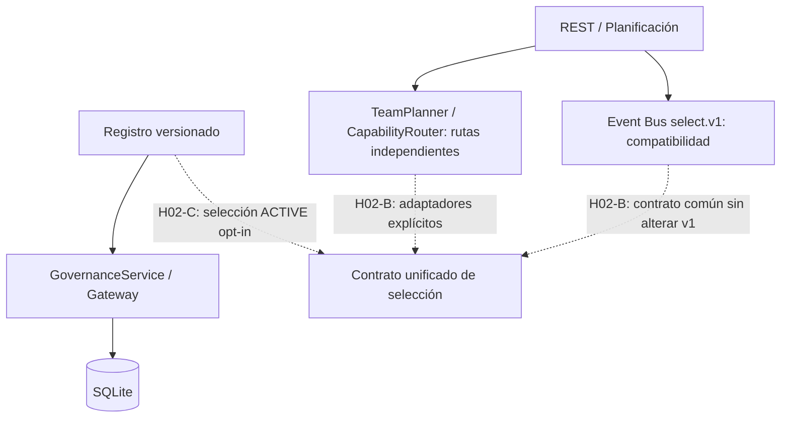

# H02-A — Inventario de integración verificable

Estado: **incremento preparado; validación local y PR pendientes**.

## Evidencia examinada en `main` (2026-10-14)

- `specialists/SpecialistEventBus.java` registra `aies.specialists.select.v1` cuando `aies.specialists.enabled` está activo; selecciona de cuatro entradas locales fijas mediante `SpecialistCatalog.select`.
- `specialists/SpecialistResource.java` expone `POST /api/v1/specialists/select`, autorizado por `WorkspaceOperatorAuthorizer`, y solicita al Event Bus v1. No equivale a autenticación de operadores v2.
- `team/TeamPlanner.java` genera pasos con IDs de perfiles de prompts (`architect`, `backend-developer`, `qa-engineer`, etc.) mediante reglas por palabras clave.
- `routing/CapabilityRouter.java` genera **preview no ejecutable** basado en términos y `prompts.SpecialistCatalog`.
- `specialists/SpecialistRegistryStore.java`, `SpecialistGovernanceService.java`, `SpecialistOperatorGateway.java` y verificadores forman una línea separada de persistencia y gobernanza. La mera presencia de clases y pruebas no acredita su integración en el selector.
- `application.properties` configura las principales capacidades de forma opt-in; un valor por defecto no demuestra su estado efectivo en despliegue.

## Herramienta reproducible

`python3 scripts/aies-integration-inventory.py --root . --output /tmp/aies-inventory.json`

Produce rutas existentes, referencias textuales Java y defaults configurados. **Una referencia estática no demuestra conectividad runtime, autorización, ejecución, ni ausencia de uso**. No clasificar como muerto ningún componente basándose exclusivamente en este informe. No se inspeccionan dependencias por reflexión, configuración CDI, mensajes dinámicos ni plugins.

## Arquitectura de transición



## Decisiones y próximos incrementos

1. **H02-B**: formalizar contrato de solicitud/respuesta, identidad versionada, `capabilityId`, herramientas permitidas, presupuesto, elegibilidad y motivo de rechazo; adaptadores para v1 y planificación, con pruebas de equivalencia. Ningún permiso surge de un rol o perfil.
2. **H02-C**: resolver `ACTIVE` desde registro gobernado mediante flag separado, fail-closed, métricas, rollback y pruebas de selección negativa; no habilitar por defecto.
3. **H02-D**: autorización real de ejecución y herramientas; revisión de identidades, scopes y separación de funciones.
4. **H02-E/F**: integración E2E, observabilidad, migración progresiva y retiro **solo** de rutas duplicadas con evidencia de ausencia de consumidores.

## Criterios de aceptación de H02-A

- Inventario ejecutable en modo solo lectura y salida JSON estable.
- Pruebas Python del escáner y suite Gradle existente sin regresiones.
- Evidencia de rutas concretas y límites explícitos del análisis estático.
- `docs/NEXT_HITOS_CONTEXT.md` actualizado incrementalmente sin reescribir historia.
- Sin cambios de producción, endpoints, Event Bus v1 ni flags.

## Pendientes de certificación

Ejecutar en Fedora:

```bash
python3 -m unittest discover -s tests/architecture -p 'test_*.py' -v
python3 scripts/aies-integration-inventory.py --root . --output /tmp/aies-inventory.json
./gradlew clean test --no-daemon --console=plain
git diff --check
```

F4/G10-K sigue OPEN; este inventario no constituye certificación de Quarkus/Ollama.
